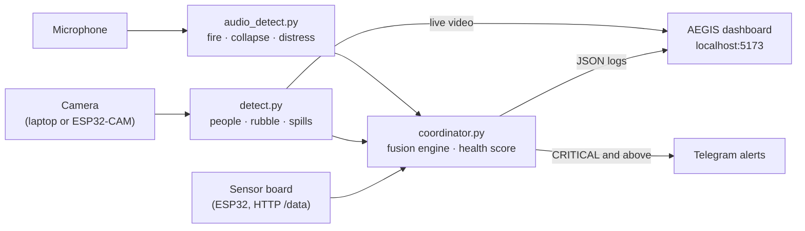
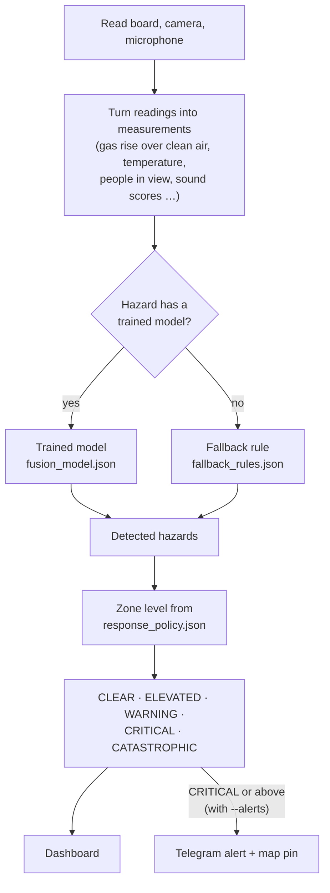
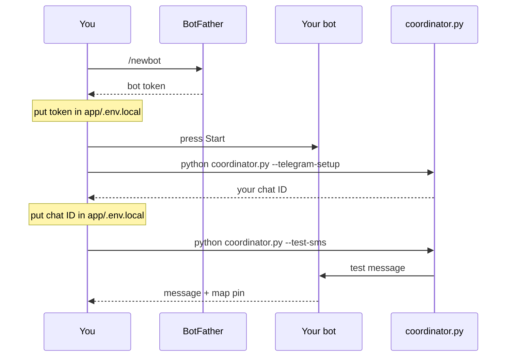
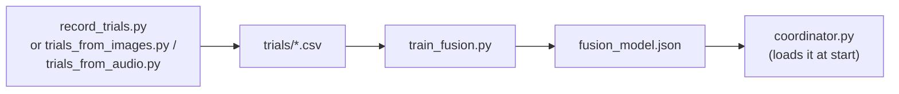

# VERDE — Disaster Response Rover

**V**isual **E**nvironmental **R**econnaissance and **D**isaster **E**valuation

A rover that watches, listens and senses a disaster zone, decides what hazards are present,
and alerts responders. The operator dashboard is called **AEGIS**.

---

## How it works



Everything runs on one laptop. The AI models run locally:

| Model | File | Finds |
|---|---|---|
| YOLOv8n | `yolov8n.pt` | People |
| Damage | `rubble.pt` | Rubble / structural damage (level 1–3) |
| Spill | `oil.pt` | Oil / chemical spills |
| YAMNet | `yamnet.tflite` | Sounds (fire, crashes, screaming, sirens…) |

---

## Quick start

**Install** (Python 3.10+, Node 18+)

```bash
pip install ultralytics opencv-python numpy tensorflow sounddevice requests
cd app && npm install
```

**Run** — four terminals, all from the repo root:

```bash
python coordinator.py                 # 1. sensors + decisions  (start in clean air)
python detect.py                      # 2. camera
python audio_detect.py                # 3. microphone
cd app && npm run dev                 # 4. dashboard → http://localhost:5173
```

Camera and microphone are optional: anything not running shows as **offline** and the rest
keeps working.

---

## How a hazard is decided

Every second the coordinator reads all inputs and runs this:



**Gas sensors** are judged by how far they rise above their own clean-air level, which the
coordinator learns from its first 30 readings. Start it in clean air. Gas readings are ignored
until the board reports its sensors are warm.

**Zone escalates to CATASTROPHIC** when a CRITICAL hazard is detected with people in view, or
two CRITICAL hazards happen together.

**Environmental Health Score** (0–100) is the chance that no hazard is present.

---

## Settings you can edit

| File | What it controls |
|---|---|
| `fallback_rules.json` | Thresholds for hazards with no trained model, e.g. gas alarm at +50% over clean air |
| `response_policy.json` | How serious each hazard is (WARNING / CRITICAL) and the action text |
| `sensor_source.py` | Sensor board address (`DEFAULT_SENSOR_IP`), and steady stand-in pressure/gyro values used while those sensors are missing (`STAND_IN`, listed in `simulated_fields`) |
| `detect.py` | Camera confidence: people 0.50, rubble 0.90, spills 0.80 |
| `coordinator.py` | Alert contacts and phone numbers |
| `app/.env.local` | Telegram bot token and chat IDs (git-ignored) |

Current fallback rules:

| Hazard | Detected when |
|---|---|
| Gas leak | MQ2 or MQ4 ≥ 50% above clean air |
| Fire / heat | Temperature ≥ 50 °C, rising ≥ 5 °C/min, or fire sound ≥ 0.5 |
| Flood / water | Water sensor wet |
| Structural damage | Rubble in ≥ 50% of camera frames over 10 s |
| Hazardous spill | Spill in ≥ 50% of camera frames over 10 s |
| Distress / collapse sound | Sound score ≥ 0.5 |
| Unstable ground | Tilt ≥ 25° |

A trained model always replaces its rule. Right now only **Human Distress Heard** is trained.

---

## Telegram alerts



`app/.env.local`:

```
TELEGRAM_BOT_TOKEN=123456789:AAH...
TELEGRAM_CHAT_IDS=9108307690:111111111
```

Then run `python coordinator.py --alerts`. Alerts fire when the zone reaches CRITICAL or
CATASTROPHIC, at most once per contact every 5 minutes. The dashboard's Send buttons use the same bot.

---

## Useful commands

```bash
python coordinator.py --sensor-ip 10.34.226.28   # board at another address
python coordinator.py --mode sim                 # simulated sensors (labelled SIMULATED)
python detect.py --source esp32 --ip <cam-ip>    # ESP32-CAM instead of the webcam
python audio_detect.py --list-devices            # pick a microphone, then --device N
python fusion_engine.py --test                   # engine tests
```

---

## Training (optional)

Trained models are more reliable than the fallback rules. To train a hazard:



```bash
python record_trials.py --label gas        # with the hardware running; follow the prompts
python record_trials.py --label clear      # a calm reference trial
pip install scikit-learn
python train_fusion.py
```

Record at least 3 trials per hazard plus 3 clear ones. Labels: `clear`, `gas`, `fire`, `water`,
`structural`, `spill`, `distress`, `collapse`, `tilt`.

---

## Project layout

```
coordinator.py        runs everything each second, sends alerts
sensor_source.py      reads the sensor board, camera and microphone state
features.py           turns readings into measurements
fusion_engine.py      trained models + fallback rules → hazards and zone level
ehs_calculator.py     Environmental Health Score
anomaly_detector.py   unusual-reading detection (shown on dashboard); simulator
detect.py             camera models + live video stream (port 8765)
audio_detect.py       YAMNet sound classification
app/                  AEGIS dashboard (React + Vite)
```

---

## Known limits

- The rubble model gives false alarms indoors (it can flag a classroom as damage), so rubble is set to WARNING, not CRITICAL.
- Gas readings are relative to clean air, not ppm.
- The camera can't tell survivors from rescuers.
- Some dashboard panels (Reports page, agency cards) still show fixed sample data.
- The dashboard's data feeds only work with `npm run dev`, not a production build.

---

MIT license — see `LICENSE`. Third-party attributions in `ATTRIBUTIONS.md`.
